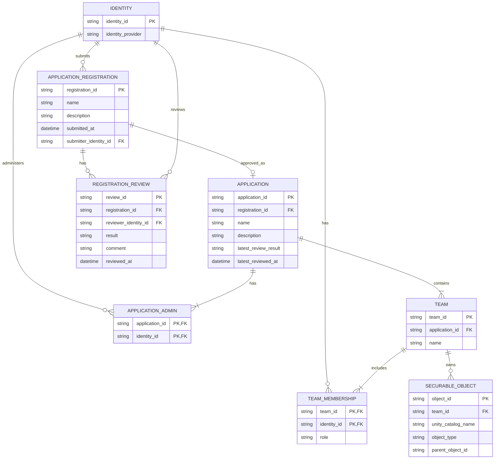
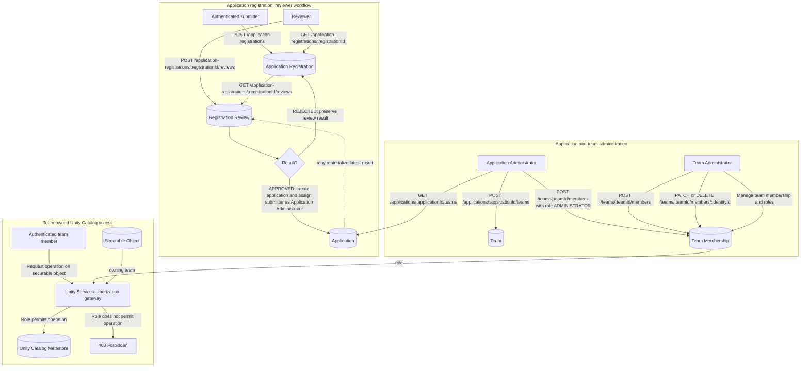

Unity Service allows multiple teams to share same Unity Catalog Metastore by providing access control to Securable Objects

The company has multiple applications. Application is implemented by teams.

Applications are registered by sugmitting application registration. Reviewer approves application registrations. The person submitted the application becomes Application Administrator. Application Administor can manage applicaton teams. Application team is managed by team administrators.

Team securable objects are managed by managing identities from the same team.

## Conceptual Data Model

An Application Registration holds the submitted application details. Each review is a separate, immutable decision record, preserving who reviewed it, the result, and when. An approved registration creates an Application and assigns its submitter as an Application Administrator. The Application may materialize the latest review result for convenient reads; Registration Review records remain the authoritative history. An Identity is identified by a stable ID from the company's identity provider; credentials are not managed by this service. Application Administrators manage application teams and assign Team Administrators. Each Team Membership has a role, and Unity Service uses that role together with the securable object's owning team to authorize requests. There are no per-object privilege grants: the role-to-action policy determines which operations a team member may perform on objects owned by that team.

## REST API Design

All endpoints use JSON under `/api/v1`. The caller's identity comes from the authenticated request, never from a caller-supplied identity field. List endpoints are paginated. Return `401` for unauthenticated requests, `403` for unauthorized requests, `404` for missing resources, `409` for conflicting state, and `422` for invalid input.

The service must verify that each team belongs to the referenced application and each securable object is associated with its owning team. The role-to-action policy is applied by Unity Service before forwarding an authorized request to Unity Catalog. Application-level administration does not implicitly grant securable-object access. Membership or role changes are the way to change a team's authorization; the API has no per-object grant or revoke endpoints.
