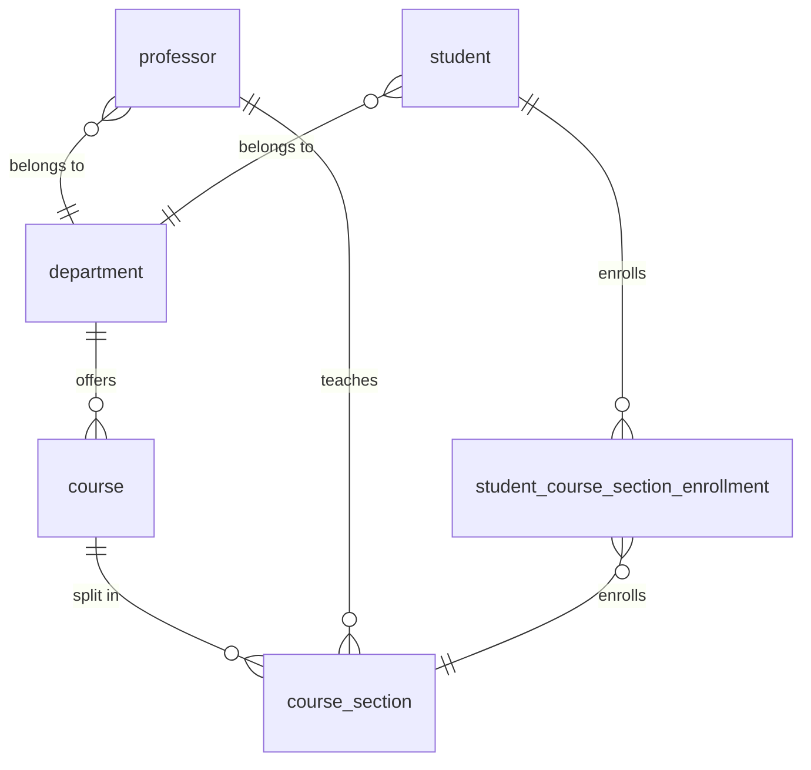

# FastAPI Student Registration

University is made of **Departments**. **Departments** offer **Courses**. **Professors** belong to a **Department** and teach multiple **Course Sections**. **Students** belong to a department and enroll in many **Course Sections**. **Course Section** has many **Student Enrollments**.

## Task 1: Create conceptual ER diagram.

