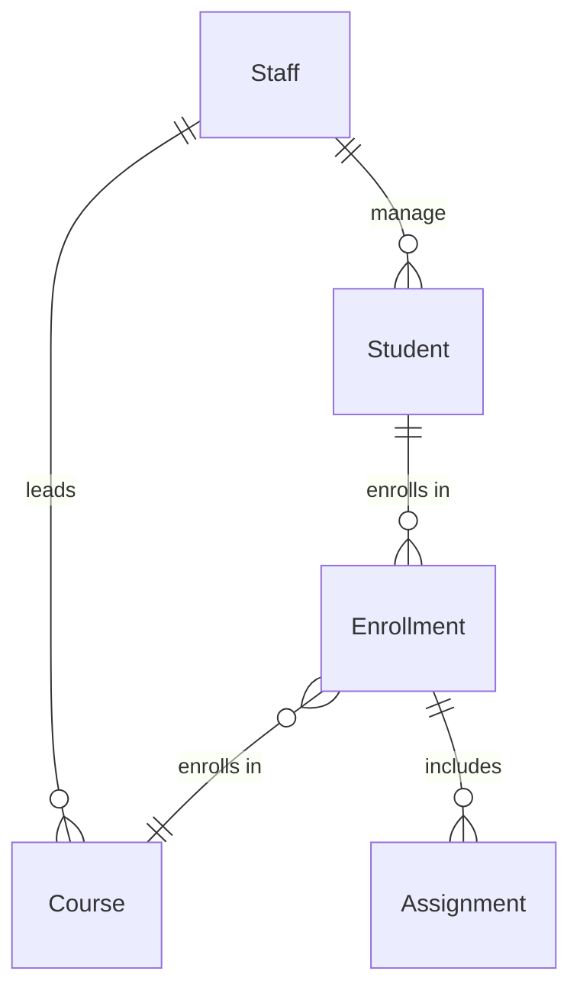
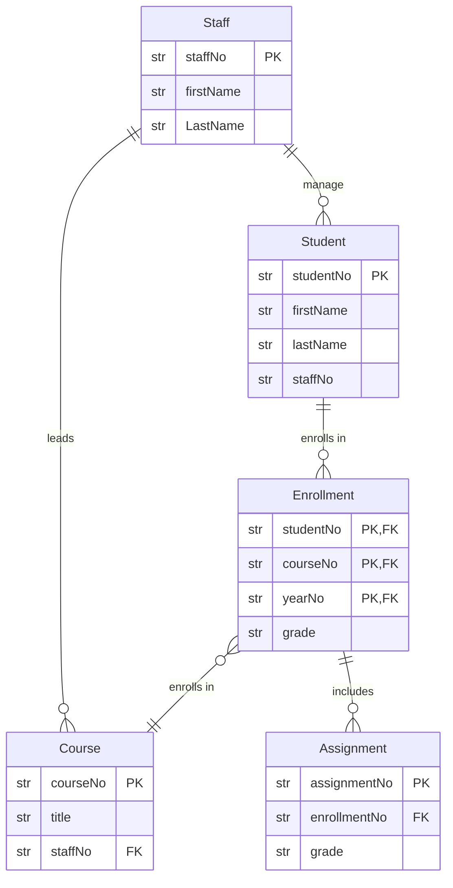

## Task 1: Design Data Model for the System

Here is the requested conceptual model.



Conceptual model could be extended into logical model:



## Task 2: Create Student ORM model.

```python

from sqlmodel import Field, SQLModel, relationship
from enum import StrEnum, auto

class Region(StrEnum):
    NORTH_IRELAND = auto()

class Student(SQLModel, table=True):
    studentNo: str = Field(default_factory=lambda: str(uuid4()), primary_key=True)
    firstName: str
    lastName: str
    region: Region
    staffNo: str = Field(foreign_key="staff.staffNo")
    staff: "Staff" = Relationship(back_populates="students")

class Staff(SQLModel, table=True):
    staffNo: str = Field(default_factory=lambda: str(uuid4()), primary_key=True)
    firstName: str
    lastName: str
    studentslist["Student"]: Relationship(back_populates="staff")
```

using SQLAlchemy

```python
from __future__ import annotations

import uuid
from typing import Annotated

from sqlalchemy import ForeignKey, String, Uuid
from sqlalchemy.orm import DeclarativeBase, Mapped, mapped_column, relationship


class Base(DeclarativeBase):
    pass


AutoPk = Annotated[
    uuid.UUID,
    mapped_column(Uuid(as_uuid=True), primary_key=True, default=uuid.uuid4),
]
Name = Annotated[str, mapped_column(String(64))]


class Staff(Base):
    __tablename__ = "staff"

    staff_no: Mapped[AutoPk]
    first_name: Mapped[Name]
    last_name: Mapped[Name]

    students: Mapped[list[Student]] = relationship(back_populates="staff")


class Student(Base):
    __tablename__ = "student"

    student_no: Mapped[AutoPk]
    first_name: Mapped[Name]
    last_name: Mapped[Name]

    staff_no: Mapped[uuid.UUID] = mapped_column(
        ForeignKey("staff.staff_no", ondelete="RESTRICT")
    )
    staff: Mapped[Staff] = relationship(back_populates="students")
```